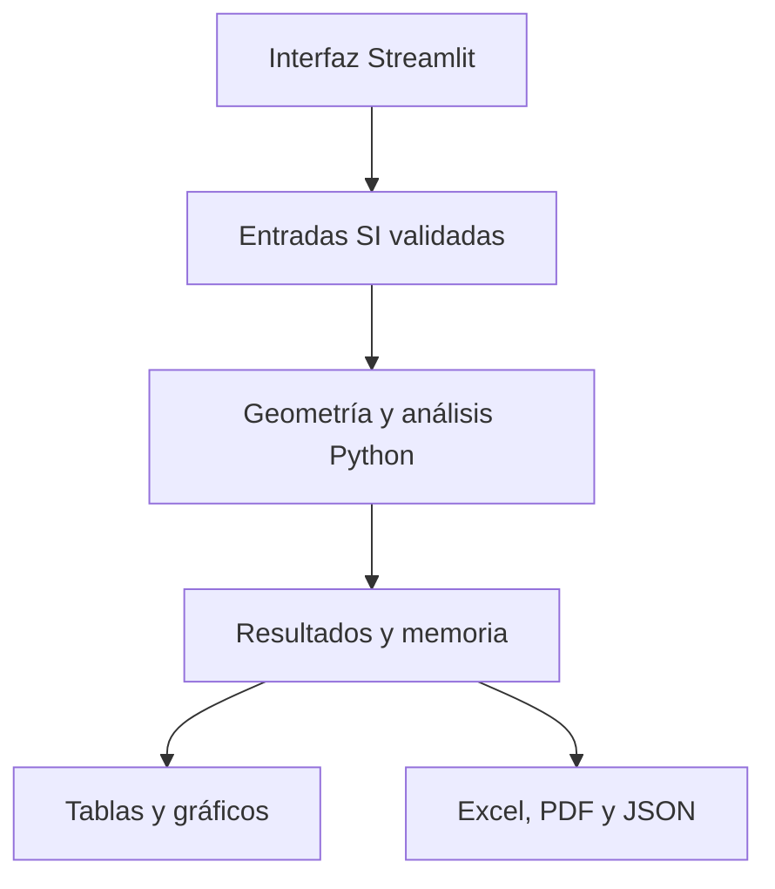

# PRE-POST 2.0 · ICIV 1042

Herramienta académica para analizar vigas de hormigón pretensado simplemente
apoyadas. Esta versión migra el cálculo del HTML anterior a **Python**, con el
núcleo en `src/` y la interfaz Streamlit en `app/`.

El documento `orden preypost.txt` se aplicó primero como un commit base literal.
Después se completó la migración para conservar el taller visual, las unidades,
los gráficos, la memoria y las exportaciones. Los tres archivos de cálculo
solicitados y `CLAUDE.md` conservan su contenido original. Los detalles y las
correcciones necesarias al ejemplo de interfaz están en [la guía de migración](docs/migracion.md).

## Ejecutar en tu computador o Codespaces

Requiere Python 3.12. Desde la carpeta del proyecto:

```bash
python -m venv .venv
```

Activa el entorno en Windows PowerShell:

```powershell
.venv\Scripts\Activate.ps1
```

En macOS/Linux/Codespaces:

```bash
source .venv/bin/activate
```

Instala e inicia:

```bash
python -m pip install -r requirements.txt
python -m streamlit run app/main.py
```

Abre la dirección que aparece en la terminal, normalmente `http://localhost:8501`.
En Codespaces, abre el puerto 8501 desde la pestaña **Ports**.

**Esta versión necesita el proceso Python en ejecución.** Ya no es un archivo
HTML que realiza cálculos por sí solo al abrirlo con doble clic. El navegador
presenta la interfaz y Python ejecuta las ecuaciones.

## Streamlit Community Cloud

Crea o configura la aplicación con:

| Campo | Valor |
|---|---|
| Repository | `figuezZ/PRE-POST-2.0` |
| Branch | `main` |
| Main file path | `app/main.py` |
| Python | `3.12` |

El punto de entrada incorpora la raíz del repositorio antes de importar `src`.
`requirements.txt` incluye las dependencias necesarias, incluido ReportLab para
la descarga directa de PDF. La aplicación antigua conectada a `PRE-POST` no
cambia de repositorio automáticamente.

## Cómo usar la plataforma

1. Selecciona **SI** o **USCS**. Cambiar de sistema convierte las entradas y los
   resultados sin cambiar físicamente la viga.
2. Completa luz, geometría, material, cargas, fuerza, excentricidad, área de acero
   y pérdida global. La carga muerta adicional no incluye el peso propio.
3. Para el alcance básico deja desactivada **Usar sección compuesta**. Para el
   taller, actívala, elige Rectangular, T, I o Hueca y pulsa **Aplicar plantilla**.
4. Edita los componentes; puedes agregar sólidos o vacíos y eliminar filas.
   Ancho, alto y cota inferior tienen las unidades indicadas en la tabla.
5. Revisa el dibujo y pulsa **Calcular etapas**.
6. Consulta **Métricas**, **Gráficos**, **Explorar tensiones**, **Memoria de cálculo**
   y **Exportar informe**.

En el editor, cambiar ancho/alto de plantilla no sustituye las filas hasta pulsar
**Aplicar plantilla**. Aplicarla también sitúa inicialmente el tendón al 10 % del
alto desde la base. Después puedes editar su excentricidad.

El explorador selecciona etapa, posición `x/L` y fibra `Y/h`. Muestra los aportes
axial, del pretensado y del momento externo, además de la tensión total. El azul
representa compresión y el rojo tracción; la escala es común a ambas etapas.
La línea de tensión cero se dibuja cuando cruza la altura de la sección.

Los resultados de las tablas de transferencia/servicio corresponden al centro de
luz. El explorador y la memoria usan la posición elegida. Cambiar entradas o
componentes exige volver a calcular; cambiar unidades solo cambia la presentación.

## Qué contiene cada archivo

| Tarea | Código |
|---|---|
| Entradas rectangulares del documento | `src/models/inputs.py` |
| Validación finita y componentes del taller | `src/models/project.py` |
| Propiedades rectangulares | `src/sections/rectangular.py` |
| Plantillas, vacíos, centroide y ejes paralelos | `src/sections/composite.py` |
| Estática y tensiones rectangulares del documento | `src/analysis/elastic.py` |
| Transferencia/servicio, fuerza efectiva, posiciones y fibras | `src/analysis/pipeline.py` |
| Memoria de 19 pasos | `src/analysis/memory.py` |
| Conversiones SI/USCS | `src/units.py` |
| Tablas compartidas de resultados | `src/reporting/tables.py` |
| Excel, PDF y JSON | `src/reporting/exports.py` |
| Gráficos Plotly | `app/plots.py` |
| Controles y pestañas | `app/main.py` |
| Autovalidación analítica | `src/validation.py` |



## Informes y unidades

- **Excel `.xlsx`:** ocho hojas con identificación, entradas, sección,
  transferencia, servicio, explorador, componentes y memoria. Las magnitudes son
  valores numéricos, no fórmulas estructurales duplicadas.
- **PDF:** informe tabulado con identificación, unidades, ambas etapas, posición,
  fibra, componentes y memoria desarrollada. Se imprime desde cualquier lector PDF.
- **JSON:** instantánea de entradas en SI y del informe, con versión de esquema.

Entradas, resultados y gráficos usan el sistema seleccionado. La memoria y el
desglose de ejes paralelos se muestran siempre en SI base y lo indican expresamente.
Los gráficos interactivos están en la plataforma; no se incrustan en Excel/PDF.
No se implementa todavía carga de proyectos JSON ni guardado automático entre sesiones.

## Verificación reproducible

```bash
python -m pip install -r requirements-dev.txt
python -m pytest
python -m src.validation --all --output outputs/validation_summary.json
```

Node.js se usa solamente en las pruebas que comparan Python con el JavaScript
anterior; no es una dependencia de la aplicación. GitHub Actions instala Node y
Python para ejecutar la suite completa. Sin Node, pytest identifica esas pruebas
como omitidas; los controles analíticos independientes siguen ejecutándose.

Se verifica equilibrio mediante integrales independientes, los 19 pasos de memoria,
las cuatro plantillas, entradas inválidas, conversiones, contenido de archivos y
el flujo Streamlit con `AppTest`. [Resultado analítico](outputs/validation_summary.json):
15 comparaciones. No equivale a una certificación estructural ni a una revisión
visual en todos los navegadores.

## Alcance académico

Núcleo en m, N y Pa; compresión negativa; excentricidad positiva hacia arriba;
momento externo sagante positivo. Un tendón bajo el centroide tiene `e < 0`.

Se conserva el control de entrada de tensión inicial del acero de 1860 MPa
pedido en el documento. No constituye un límite normativo de pretensado.
Las pérdidas se ingresan como porcentaje global; no se calculan por mecanismo.

El taller admite rectángulos centrados horizontalmente y apilados, con vacíos
rectangulares contenidos en un sólido. No incluye sección transformada con acero,
fisuración, flecha, resistencia, múltiples tendones ni comprobaciones ACI.
El área de hormigón descuenta los vacíos dibujados; no descuenta automáticamente Ap.

Consulta [alcance](docs/alcance.md), [fórmulas](docs/formulas.md) y
[matriz del Avance 1](docs/matriz_requisitos.md) para distinguir lo implementado de
lo pendiente para la entrega.
